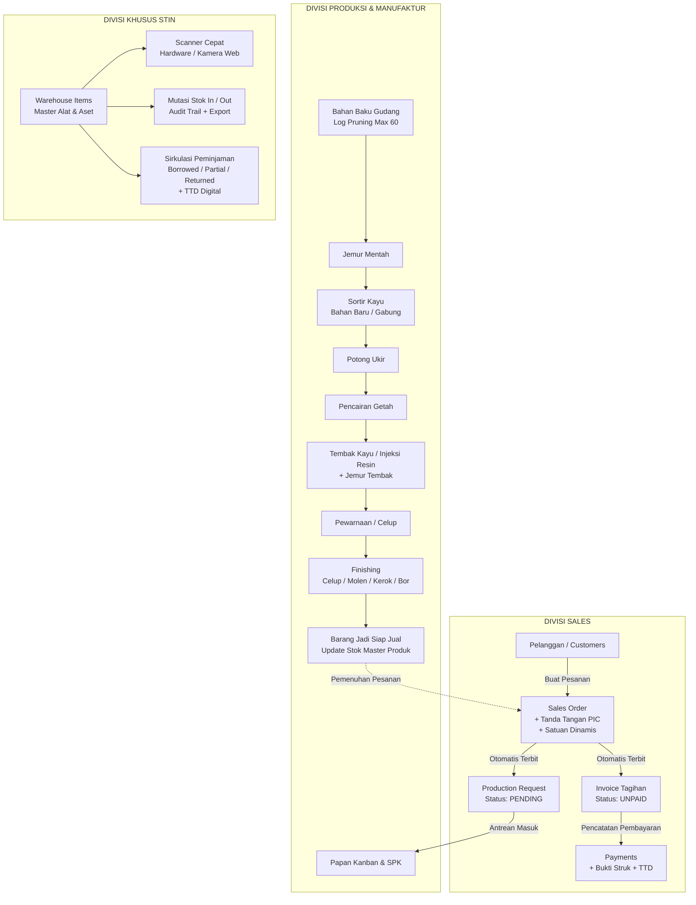
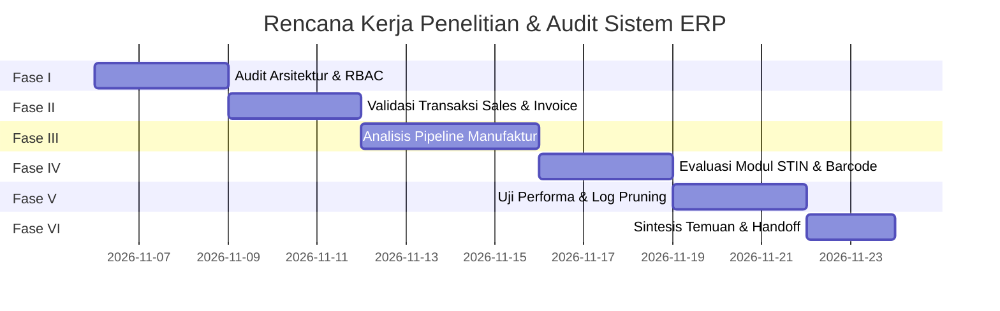

# HANDOFF & PERANCANGAN PENELITIAN SISTEM ERP TERINTEGRASI
**DIV Sales, DIV Produksi, dan DIV STIN (Warehouse & Assets)**  
*Dokumen Analisis Arsitektur, Evaluasi Domain Bisnis, dan Desain Riset Sistematis*

---

## DAFTAR ISI
1. [Ringkasan Eksekutif & Status Sistem](#1-ringkasan-eksekutif--status-sistem)
2. [Pemahaman Menyeluruh Arsitektur & Domain Sistem](#2-pemahaman-menyeluruh-arsitektur--domain-sistem)
   - 2.1. Spesifikasi Teknologi & Tech Stack
   - 2.2. Dekomposisi Modul & Alur Bisnis Lintas Divisi
   - 2.3. Skema Data & Relasi Entitas Kunci
   - 2.4. Standar Desain Antarmuka (Liquid Glass & Monochrome System)
3. [Perancangan Penelitian Terhadap Sistem (Research Framework)](#3-perancangan-penelitian-terhadap-sistem-research-framework)
   - 3.1. Latar Belakang & Urgensi Penelitian
   - 3.2. Rumusan Masalah Penelitian (Research Questions)
   - 3.3. Tujuan Penelitian (Objektif Utama & Khusus)
   - 3.4. Batasan & Ruang Lingkup Penelitian
4. [Metodologi Penelitian & Protokol Audit](#4-metodologi-penelitian--protokol-audit)
   - 4.1. Pendekatan Penelitian (Multi-Layer Assessment)
   - 4.2. Instrumen, Alat Uji, dan Lingkungan Riset
   - 4.3. Matriks Pengujian & Kriteria Validasi
5. [Rencana Aksi Bertahap (Step-by-Step Research Roadmap)](#5-rencana-aksi-bertahap-step-by-step-research-roadmap)
   - Tahap I: Audit Fondasi Arsitektur, RBAC, dan Skema Database
   - Tahap II: Investigasi Logika Transaksional Modul Sales & Keuangan
   - Tahap III: Eksplorasi Pipeline Konversi Manufaktur (Sortir s/d Finishing)
   - Tahap IV: Evaluasi Modul STIN (Barcode/QR, Scanner Hardware, & Sirkulasi Pinjaman)
   - Tahap V: Uji Performa, Skalabilitas Multi-Branch, dan Pruning Audit Log
   - Tahap VI: Sintesis Temuan, Mitigasi Risiko, dan Panduan Handoff
6. [Inventaris Risiko, Temuan Awal, dan Rekomendasi Mitigasi](#6-inventaris-risiko-temuan-awal-dan-rekomendasi-mitigasi)
7. [Metrik Keberhasilan Penelitian (Success Metrics)](#7-metrik-keberhasilan-penelitian-success-metrics)
8. [Panduan Operasional & Catatan Pengembang (Developer Notes)](#8-panduan-operasional--catatan-pengembang-developer-notes)

---

## 1. RINGKASAN EKSEKUTIF & STATUS SISTEM

Proyek ini merupakan sistem **Enterprise Resource Planning (ERP)** berbasis web yang dirancang untuk mengintegrasikan seluruh lini operasional perusahaan: mulai dari komersial (*Sales*), rantai manufaktur bertingkat (*Production*), pergudangan internal & peminjaman peralatan/aset khusus (*STIN*), hingga manajemen prospek (*CRM*) dan kanal daring (*E-Commerce*).

Saat ini, aplikasi berada pada status **Beta v.1.1.2** (pengembangan berkelanjutan dari rilis Beta v.0.0.1 per 31 Agustus 2026 dan update manufaktur per September-Oktober 2026). Fondasi aplikasi dibangun menggunakan standar Laravel modern yang berfokus pada:
- **Ketahanan Transaksional (ACID Guarantees):** Penggunaan `DB::transaction()` tanpa kompromi pada setiap operasi lintas tabel.
- **Integritas Relasional:** Aturan `RESTRICT` pada relasi data master dan historis transaksi keuangan/produksi guna mencegah *data loss* atau *orphan records*.
- **Desain Korporat Fungsional:** Mengadopsi prinsip antarmuka monokrom *colorless & icon-less content* berpadu dengan komponen interaktif *Liquid Glass* (`apple-glass-panel` solid, backdrop blur, dan dropdown combobox dengan opsi pendaftaran *on-the-fly*).

Dokumen ini disusun sebagai **perancangan penelitian komprehensif** sekaligus **dokumen handoff** untuk membedah, menguji, dan mengarahkan pengembangan sistem secara terstruktur dan terukur.

---

## 2. PEMAHAMAN MENYELURUH ARSITEKTUR & DOMAIN SISTEM

### 2.1. Spesifikasi Teknologi & Tech Stack
- **Framework Utama:** Laravel 11.x
- **Bahasa & Runtime:** PHP 8.3 (memanfaatkan Backed Enums, Constructor Property Promotion, Type Safety, dan Match Expressions)
- **Database Mesin:** MySQL (Production & Staging), didukung SQLite in-memory untuk kecepatan eksekusi automated test suite
- **Asset Bundler & Styling:** Vite 8.x + Tailwind CSS v4
- **Paket Integrasi Khusus:**
  - `picqer/php-barcode-generator`: Pembangkit barcode fisik (Code 128) format SVG/PNG untuk label inventaris
  - `simplesoftwareio/simple-qrcode`: Generator kode QR dinamis untuk identifikasi cepat item STIN
  - `maatwebsite/excel` (v4.0): Layanan impor dan ekspor data spreadsheet (Excel/CSV UTF-8 BOM)
- **Automated Testing & Code Quality:** PHPUnit 12.x, Laravel Pint (PSR-12 standard)

### 2.2. Dekomposisi Modul & Alur Bisnis Lintas Divisi



#### A. Divisi Sales (Komersial)
1. **Manajemen Pelanggan (`Customer`):**
   - Mendukung pencatatan kontak, alamat, dan status aktif dengan *Soft Deletes*.
   - Menyediakan fitur *Accordion Transaction History* yang menghitung secara dinamis akumulasi pembelian (*lifetime sales*) dan total saldo piutang tertunggak (*outstanding balance*).
2. **Sales Order (`SalesOrder` & `SalesOrderItem`):**
   - Mendukung satuan dinamis (*Units of Measure*: `kg`, `gram`, `pcs`, `unit`, `box`, `karung`, dsb.) dengan kuantitas desimal presisi (misal: `12.75 kg`).
   - Wajib menyertakan Nama PIC (Penanggung Jawab) dan tanda tangan digital (*signature canvas*) saat pembuatan order.
   - **Otomasi Terintegrasi:** Saat Sales Order disimpan, sistem secara otomatis:
     - Menerbitkan dokumen **Production Request** (`#PR-...`) berstatus `PENDING` ke divisi manufaktur.
     - Menerbitkan dokumen **Invoice** (`#INV-...`) berstatus `UNPAID` dengan termin jatuh tempo 30 hari.
3. **Faktur & Pembayaran (`Invoice` & `Payment`):**
   - Transisi status: `UNPAID` -> `PARTIAL` -> `PAID`.
   - Pembayaran mewajibkan lampiran berkas bukti (JPG, PNG, PDF via Laravel `Storage`), identitas PIC, dan tanda tangan digital penerima kas.
4. **Excel Import/Export:**
   - Tersedia pada Customer, Sales Order, dan Invoice lengkap dengan template input berdesain *Liquid Glass modal*.

#### B. Divisi Produksi & Manufaktur
Alur manufaktur mengadopsi model pemrosesan bertahap (*multi-stage sequential pipeline*):
1. **Manajemen Bahan Mentah (`Material` & `MaterialBranch`):**
   - Penerimaan barang masuk dengan bukti nota dan tanda tangan.
   - Fitur Stock Opname / Penimbangan Ulang (`recount`).
   - Log riwayat mutasi alur barang yang dibatasi secara otomatis maksimal 60 rekaman (`MaterialService::pruneOldLogs(60)`) demi efisiensi query.
2. **Sortir Bahan Mentah (`MaterialSortBatch`):**
   - Pemilahan kayu mentah setelah penjemuran: dialokasikan menjadi jenis bahan baku baru atau digabungkan (*merge*) ke bahan yang sudah ada dengan validasi kesamaan satuan unit yang ketat.
3. **Potong Ukir (`MaterialCarveBatch`):**
   - Pemotongan dan pengukiran kayu mentah menjadi bahan setengah jadi disertai pencatatan persentase susut.
4. **Pencairan Getah (`MaterialMeltBatch`):**
   - Konversi getah/resin padat menjadi cairan melalui pemanasan dan pemantauan penguapan berkala.
5. **Tembak Kayu / Injeksi Resin (`ProductionTembakBatch`):**
   - Injeksi resin ke dalam kayu, penimbangan hasil tembak basah, pemantauan jemur (*drying log*), dan pengembalian sisa resin cair ke gudang.
6. **Celup & Pewarnaan (`ProductionColoringBatch`):**
   - Proses perendaman dan pewarnaan bahan tembak kering.
7. **Finishing (`ProductionFinishingSession`):**
   - Rangkaian proses finishing modular (Celup, Molen, Kerok, Bor) tanpa urutan kaku yang menghasilkan produk barang jadi untuk disinkronkan ke katalog produk utama (`Product`).

#### C. Divisi STIN (Gudang Khusus & Aset)
1. **Katalog Aset & Inventaris (`WarehouseItem`):**
   - Pengelompokan kategori barang, lokasi rak (*WarehouseLocation*), dan ambang batas stok minimum (*low stock alert*).
   - Cetak label barcode fisik standar industri (ukuran Standard 50x30mm, Compact 40x25mm, Large 70x40mm) yang mendukung barcode Code 128 dan QR Code resolusi tinggi.
2. **Antarmuka Scanner Cepat (`StinScannerController`):**
   - Mendukung pemindaian perangkat barcode gun (keyboard wedge) dan kamera perangkat secara instan (*search-as-you-type* & batch actions).
3. **Sirkulasi Peminjaman & Pengembalian (`WarehouseLoan` & `WarehouseLoanReturn`):**
   - Alur peminjaman aset untuk kebutuhan operasional, pameran, atau sampel etalase.
   - Validasi pengembalian parsial atau lengkap, verifikasi kondisi fisik barang (*good, damaged, lost*), dan validasi otentikasi tanda tangan digital.

#### D. Divisi CRM & E-Commerce
- Menyediakan modul dasbor terspesialisasi berbasis peran (`admin_crm` dan `admin_ecommerce`) yang siap dikembangkan lebih lanjut untuk pengelolaan kanal digital dan prospek kemitraan.

### 2.3. Skema Data & Relasi Entitas Kunci
- **Model Otorisasi Berbasis Peran:** Dikelola melalui Backed Enum `UserRole`:
  - `SUPER_ROLE`: Akses tanpa batas ke seluruh divisi.
  - `SALES`: CRUD Pelanggan, Order Penjualan, Faktur; Akses *Read-Only* ke stok produk dan antrean produksi.
  - `PRODUCTION`: Akses penuh modul manufaktur, bahan baku gudang, SPK, dan pembaruan stok produk.
  - `STIN`: Akses khusus pergudangan internal, pemindaian SKU, mutasi, dan sirkulasi peminjaman.
  - `ADMIN_CRM` & `ADMIN_ECOMMERCE`: Akses ke modul masing-masing.
- **Konvensi Moneter:** Semua kolom finansial (`price`, `total_amount`, `subtotal`, `amount`, `unit_cost`) didefinisikan presisi dengan `DECIMAL(15, 2)`.
- **Foreign Key Constraints:** Menggunakan `onDelete('restrict')` pada hubungan transaksional krusial untuk mencegah inkonsistensi data akuntansi dan histori produksi.

### 2.4. Standar Desain Antarmuka (Liquid Glass & Monochrome System)
1. **Monokrom Korporat (*Colorless & Icon-less Content*):** Menghilangkan aksen warna-warni kasual, menggantinya dengan palet `slate-900`, `white`, dan `badge-dark` dengan tipografi bersih.
2. **Search-as-you-type Liquid Glass Combobox:** Dropdown input relasi bertingkat mengambang (*floating* `z-50`), memiliki opasitas tinggi (`bg-white/95 backdrop-blur-3xl`), dengan tombol aksi registrasi instan **`+ Tambah Baru`** selalu berada di urutan teratas.
3. **Floating Glass Sidebar:** Navigasi samping dengan transisi dinamis: teks menu menghilang instan dalam `60ms`, lebar panel menciut stabil selama `650ms`, dan teks kembali muncul mulus setelah jeda `220ms`.
4. **Pad Tanda Tangan Digital:** Integrasi canvas interaktif HTML5 pada form Sales Order, Pembayaran Faktur, Sortir Bahan Baku, dan Peminjaman STIN.

---

## 3. PERANCANGAN PENELITIAN TERHADAP SISTEM (RESEARCH FRAMEWORK)

### 3.1. Latar Belakang & Urgensi Penelitian
Sistem ERP ini melayani alur rantai nilai terintegrasi dengan tingkat kompleksitas tinggi:
1. Hubungan data transaksional otomatis antara pesanan penjualan, permintaan produksi, dan penerbitan faktur tagihan.
2. Proses konversi manufaktur multi-fase di mana bahan baku mentah mengalami perubahan wujud fisik (padat -> cair -> injeksi -> kering -> finishing) yang menyebabkan fluktuasi massa/kuantitas (penyusutan, penguapan getah, dan pemilahan kualitas).
3. Manajemen pergerakan fisik barang pada divisi STIN yang menuntut akurasi *real-time* saat dipindai menggunakan *barcode scanner*.

Oleh karena itu, diperlukan perancangan penelitian komprehensif untuk mengevaluasi stabilitas, integritas, performa, dan skalabilitas arsitektur sebelum sistem dideploy secara luas ke fasilitas produksi multi-cabang.

### 3.2. Rumusan Masalah Penelitian (Research Questions)
Penelitian ini dirancang untuk menjawab 6 (enam) pertanyaan fundamental:
- **RQ-1 (Integritas Transaksional Otomatis):** Bagaimana efektivitas implementasi `DB::transaction()` dan State Machine di *Service Layer* dalam mencegah anomali data (misal: pesanan tercipta tanpa Production Request atau Invoice ganda) pada kondisi *concurrent requests*?
- **RQ-2 (Fleksibilitas Konversi Satuan & Massa):** Sejauh mana skema *Units of Measure (UoM)* dinamis dan nilai kuantitas desimal mampu mengakomodasi fluktuasi massa bahan baku (penyusutan potong ukir, penguapan getah cair, dan efisiensi injeksi resin) secara akurat tanpa kehilangan presisi numerik?
- **RQ-3 (Ketepatan & Latensi Pelacakan Gudang STIN):** Bagaimana performa latensi, keandalan decoding barcode Code 128 / QR Code, serta ketahanan integritas data sirkulasi pinjaman (*Warehouse Loan/Return*) pada modul STIN di bawah variasi beban data inventaris?
- **RQ-4 (Efisiensi Query & Mekanisme Pruning):** Apakah strategi pemangkasan rekaman log gudang maksimal 60 baris (`MaterialService::pruneOldLogs`) efektif menjaga performa query tanpa mengorbankan jejak audit (*auditability*) kepatuhan industri?
- **RQ-5 (Keamanan RBAC & Isolasi Data Divisi):** Apakah implementasi otorisasi berbasis peran (`EnsureUserHasRole` & *Policy Classes*) telah menjamin isolasi hak akses secara ketat, khususnya mencegah staf Sales memodifikasi data lini produksi manufaktur?
- **RQ-6 (Kesiapan Skalabilitas & Portabilitas Penyimpanan):** Bagaimana kesiapan arsitektur sistem untuk transisi penyimpanan berkas lokal ke Amazon S3 dan skalabilitas pelacakan multi-cabang pabrik (*multi-branch manufacturing*)?

### 3.3. Tujuan Penelitian (Objektif Utama & Khusus)
- **Tujuan Utama:** Menghasilkan evaluasi mendalam mengenai keandalan arsitektur perangkat lunak, integritas data transaksional, serta menyusun cetak biru (*blueprint*) optimasi untuk kesiapan operasional skala penuh sistem ERP.
- **Tujuan Khusus:**
  1. Mengaudit kepatuhan arsitektur kode terhadap prinsip Clean Architecture dan kaidah Laravel Enterprise.
  2. Menguji ketahanan matematis dan transaksional pada proses konversi bahan baku menjadi barang jadi.
  3. Memvalidasi akurasi decoding dan ergonomi pencetakan barcode inventaris STIN.
  4. Menyajikan matriks mitigasi risiko dan rekomendasi perbaikan sebelum rilis produksi mayor.

### 3.4. Batasan & Ruang Lingkup Penelitian
- **Ruang Lingkup Sistem:** Berfokus pada 3 modul aktif utama: **DIV Sales**, **DIV Produksi**, dan **DIV STIN**, dengan modul CRM dan E-Commerce dievaluasi sebatas kesiapan fondasi integrasinya.
- **Lingkungan Pengujian:** PHP 8.3, Laravel 11.x, basis data MySQL 8.x pada lingkungan lokal/staging serta SQLite in-memory untuk eksekusi regression test suite.

---

## 4. METODOLOGI PENELITIAN & PROTOKOL AUDIT

### 4.1. Pendekatan Penelitian (Multi-Layer Assessment)
Penelitian ini menggunakan pendekatan kombinasi (*mixed-method empirical software engineering*):

```
+--------------------------------------------------------------------------+
|                       LAPISAN 1: AUDIT ARSITEKTUR                        |
|        Analisis Statis Kode, Batas Dependensi, Standar PSR-12 (Pint)      |
+--------------------------------------------------------------------------+
                                    |
                                    v
+--------------------------------------------------------------------------+
|                  LAPISAN 2: INTEGRITAS TRANSITIONAL                      |
|       Uji ACID DB::transaction(), State Machine, & Constraint RESTRICT    |
+--------------------------------------------------------------------------+
                                    |
                                    v
+--------------------------------------------------------------------------+
|                   LAPISAN 3: LOGIKA DOMAIN & KONVERSI                    |
|   Simulasi Pipeline Bahan (Sortir -> Ukir -> Melt -> Tembak -> Finishing) |
+--------------------------------------------------------------------------+
                                    |
                                    v
+--------------------------------------------------------------------------+
|                  LAPISAN 4: INTEGRASI PERANGKAT & HARDWARE                |
|      Validasi Barcode/QR Code STIN, Scanner I/O, Thermal Print Sizing    |
+--------------------------------------------------------------------------+
                                    |
                                    v
+--------------------------------------------------------------------------+
|                  LAPISAN 5: PERFORMA, STRES & AUDIT LOG                  |
|    Evaluasi Throughput Query, Pruning Log Database, Ekspor/Impor Excel    |
+--------------------------------------------------------------------------+
```

### 4.2. Instrumen, Alat Uji, dan Lingkungan Riset
1. **Pengujian Fungsional Otomatis:** PHPUnit 12.x (`Feature` dan `Unit` tests) dengan eksekusi terfokus.
2. **Inspeksi Kualitas Kode:** Laravel Pint (`vendor/bin/pint --format agent`).
3. **Database Inspection Tools:** Skrip inspeksi skema dan query logs untuk memantau waktu eksekusi serta *deadlock contention*.
4. **Hardware Simulator:** Pengujian format cetak termal barcode pada resolusi skala 1:1 (Label 50x30mm, 40x25mm, 70x40mm) dan verifikasi respon pemindai optik.

### 4.3. Matriks Pengujian & Kriteria Validasi

| ID Pengujian | Komponen yang Diuji | Parameter Evaluasi | Kriteria Keberhasilan (Pass Threshold) |
|---|---|---|---|
| **TEST-01** | `SalesOrderService` | Eksekusi transaksi pembuatan SO bersama PR dan Invoice | 100% atomik; jika satu baris item gagal, tidak ada data terbitan tersimpan. |
| **TEST-02** | `SalesOrderStatus` | Transisi status non-valid (misal: `draft` -> `completed`) | Melemparkan `InvalidArgumentException`, database tidak berubah. |
| **TEST-03** | `MaterialSortService` | Penggabungan bahan dengan satuan berbeda (misal `kg` ke `pcs`) | Permintaan ditolak dengan pesan kesalahan validasi yang jelas. |
| **TEST-04** | `MaterialService` | Pemangkasan log riwayat mutasi bahan | Total log pada tabel tidak pernah melebihi 60 rekaman per material. |
| **TEST-05** | `StinScannerController` | Waktu respon lookup SKU via barcode | Respon JSON kembali dalam waktu < 120 ms. |
| **TEST-06** | `WarehouseLoanService` | Pengembalian parsial aset dengan kondisi rusak | Status pinjaman menjadi `partial`, sisa qty terhitung presisi, log mutasi tercatat. |
| **TEST-07** | `EnsureUserHasRole` | Upaya role Sales mengakses endpoint `PUT /production/*` | Mengembalikan status HTTP 403 Forbidden secara konsisten. |
| **TEST-08** | `ExcelImportExportService`| Ekspor file CSV UTF-8 BOM pada ratusan data | File terbuka rapi di Microsoft Excel tanpa distorsi format karakter. |

---

## 5. RENCANA AKSI BERTAHAP (STEP-BY-STEP RESEARCH ROADMAP)

Perancangan penelitian diorganisasikan ke dalam 6 fase terstruktur:



### Tahap I: Audit Fondasi Arsitektur, RBAC, dan Skema Database
- **Tugas Penyelidikan:**
  1. Memverifikasi seluruh skema migrasi database terhadap kepatuhan aturan moneter `DECIMAL(15,2)` dan constraint `RESTRICT`.
  2. Menguji middleware `EnsureUserHasRole` dan integrasi method `hasRole()` / `canAccessModule()` pada model `User`.
  3. Memeriksa konsistensi penggunaan Backed Enums pada seluruh entitas berstatus (`SalesOrderStatus`, `InvoiceStatus`, `ProductionRequestStatus`, `WarehouseLoanStatus`, `UserRole`).
- **Target Output:** Laporan kepatuhan arsitektur dasar dan perbaikan celah otorisasi (jika ditemukan).

### Tahap II: Investigasi Logika Transaksional Modul Sales & Keuangan
- **Tugas Penyelidikan:**
  1. Menganalisis alur pembuatan Sales Order, pembuatan nomor acak unik (`SO-...`, `PR-...`, `INV-...`), dan penanganan *concurrency*.
  2. Menguji integritas perhitungan saldo piutang pelanggan (*outstanding balance*) pada transaksi faktur bertahap (*partial payments*).
  3. Menguji fungsionalitas unggah bukti pembayaran melalui facade `Storage` dan penanganan berkas multi-format.
  4. Menguji keandalan parsing spreadsheet pada fitur Excel Import/Export.
- **Target Output:** Verifikasi nol anomali (*zero-anomaly verification*) pada alur akuntansi penjualan.

### Tahap III: Eksplorasi Pipeline Konversi Manufaktur (Sortir s/d Finishing)
- **Tugas Penyelidikan:**
  1. Meneliti alur siklus bahan: Bahan Baku Mentah -> Jemur -> Sortir -> Ukir -> Pencairan -> Tembak Injeksi -> Pewarnaan -> Finishing.
  2. Menguji mekanisme perhitungan penyusutan berat (*drying log* dan *melt vapor log*).
  3. Menguji sinkronisasi hasil finishing ke master produk (`ProductBranch` dan stok katalog).
  4. Menguji antarmuka papan Kanban produksi dalam merefleksikan status pengerjaan riil di lantai pabrik.
- **Target Output:** Matriks konversi bahan dan validasi integritas konversi satuan manufaktur.

### Tahap IV: Evaluasi Modul STIN (Barcode/QR, Scanner Hardware, & Sirkulasi Pinjaman)
- **Tugas Penyelidikan:**
  1. Menguji akurasi generasi barcode Code 128 dan QR Code pada berbagai dimensi label cetak (`print-sku.blade.php`).
  2. Menguji performa endpoint scanner (`/stin/scanner/lookup` dan `/stin/scanner/batch-action`) terhadap input barcode fisik secara beruntun (*rapid firing scans*).
  3. Memvalidasi alur peminjaman aset: validasi stok tersedia saat dipinjam, pengurangan stok, pencatatan tanda tangan peminjam, dan alur pengembalian parsial dengan status kondisi fisik berbeda (*good, damaged, lost*).
- **Target Output:** Panduan kalibrasi cetak barcode dan sertifikasi modul inventaris STIN.

### Tahap V: Uji Performa, Skalabilitas Multi-Branch, dan Pruning Audit Log
- **Tugas Penyelidikan:**
  1. Mengukur efektivitas metode `pruneOldLogs(60)` pada tabel `material_logs` saat terjadi penambahan data intensif.
  2. Menganalisis latensi query pada dasbor STIN dan Dasbor Produksi ketika jumlah data mutasi meningkat.
  3. Menguji kesiapan integrasi multi-cabang pabrik (`ProductBranch` dan `MaterialBranch`).
- **Target Output:** Laporan benchmark performa dan konfigurasi optimal pemangkasan data.

### Tahap VI: Sintesis Temuan, Mitigasi Risiko, dan Panduan Handoff
- **Tugas Penyelidikan:**
  1. Mengonsolidasikan seluruh catatan penelitian ke dalam rekomendasi final.
  2. Memastikan seluruh unit dan feature test berjalan hijau (`pass`).
  3. Melakukan standarisasi kode dengan Laravel Pint.
- **Target Output:** Dokumen handoff final yang siap ditindaklanjuti oleh tim pengembang inti.

---

## 6. INVENTARIS RISIKO, TEMUAN AWAL, DAN REKOMENDASI MITIGASI

Berdasarkan investigasi bertahap pada struktur kode yang ada, berikut adalah daftar risiko operasional dan teknis yang telah diidentifikasi beserta rencana mitigasinya:

| Area Sistem | Risiko Potensial | Dampak | Rekomendasi Solusi & Mitigasi |
|---|---|---|---|
| **Manufaktur (Audit Log)** | Pemangkasan log permanen (`pruneOldLogs(60)`) menghapus riwayat historis masa lalu. | Kehilangan data riwayat transaksi jika dibutuhkan untuk audit eksternal tahunan. | Terapkan tabel arsip sekunder (`material_logs_archive`) sebelum baris data dipangkas dari tabel utama. |
| **Sales (Penomoran Order)** | Penomoran berbasis `uniqid()` (`SO-Ymd-XXXX`) berpotensi mengalami tabrakan (*collision*) pada volume transaksi sangat tinggi per detik. | Duplikasi nomor order yang memicu kegagalan transaksi database. | Terapkan sequence counter berbasis database atomik atau UUID v7 terurut waktu. |
| **STIN (Peminjaman Aset)** | Pengembalian barang parsial yang rusak (*damaged/lost*) dapat membingungkan nilai stok layak pakai. | Perbedaan stok fisik yang siap dipinjam kembali dengan barang yang rusak. | Pisahkan status stok `WarehouseItem` menjadi `available_stock`, `in_loan`, dan `damaged_stock`. |
| **Penyimpanan Berkas** | Berkas bukti bayar dan tanda tangan tersimpan di disk lokal (`storage/app/public`). | Kesulitan sinkronisasi saat aplikasi di-scale ke lingkungan multi-server atau container cloud. | Konfigurasi driver filesystem menggunakan variabel environment `FILESYSTEM_DISK=s3` dengan facade `Storage`. |
| **Pencetakan Barcode** | Pengaturan margin browser pengguna dapat memotong batas label cetak termal. | Barcode terpotong dan tidak terbaca oleh pemindai optik. | CSS `@media print` telah diatur dengan `@page { margin: 0; size: auto; }` dan dimensi fix dalam milimeter (`mm`). Pertahankan aturan ini. |

---

## 7. METRIK KEBERHASILAN PENELITIAN (SUCCESS METRICS)

Penelitian dan audit ini dinyatakan tuntas dan berhasil apabila memenuhi indikator kinerja berikut:
1. **Automated Test Coverage:** Seluruh Feature dan Unit Tests (saat ini 21 berkas pengujian) dieksekusi dengan status **100% Passed** tanpa kegagalan assertion.
2. **Kepatuhan Format Kode:** Nilai kebersihan 100% terhadap standar Laravel Pint tanpa pelanggaran styling PSR-12.
3. **Validasi Atomik Transaksional:** Terbukti secara empiris tidak ada kondisi di mana data pesanan tersimpan tanpa kelengkapan entitas terkaitnya saat simulasi kegagalan injeksi.
4. **Presisi Finansial & Satuan:** Tidak ditemukan galat pembulatan (*rounding errors*) pada konversi mata uang atau kuantitas multi-satuan desimal.
5. **Ergonomi Pemindaian:** Barcode yang dihasilkan terbaca oleh pemindai fisik maupun kamera dalam waktu kurang dari 1 detik dengan tingkat akurasi decoding 100%.

---

## 8. PANDUAN OPERASIONAL & CATATAN PENGEMBANG (DEVELOPER NOTES)

### 8.1. Perintah Penting untuk Pengembang
- **Menjalankan Automated Tests:**
  ```bash
  php artisan test --compact
  # Menjalankan pengujian per modul spesifik:
  php artisan test tests/Feature/SalesOrderTest.php
  php artisan test tests/Feature/StinModuleTest.php
  php artisan test tests/Feature/ProductionKanbanTest.php
  ```
- **Memformat Kode Sesuai Standar Proyek (Pint):**
  ```bash
  vendor/bin/pint --format agent
  ```
- **Mengompilasi Aset Frontend (Vite):**
  ```bash
  npm run build
  # atau untuk mode pengembangan langsung:
  npm run dev
  ```
- **Reset & Seeding Basis Data Pengujian:**
  ```bash
  php artisan migrate:fresh --seed
  ```

### 8.2. Catatan Lingkungan Kerja Aktif
- **Perubahan Belum Ter-commit (Unstaged):**
  Terdapat penyesuaian CSS & styling pada:
  - `resources/views/layouts/app.blade.php`: Pengondisian navigasi sidebar yang dapat diciutkan (*collapsible sections*) dan styling *scrollbar-none*.
  - `resources/views/stin/items/print-sku.blade.php`: Kalibrasi dimensi fisik label cetak barcode (Standard 50x30mm, Compact 40x25mm, Large 70x40mm) untuk pencetak termal.
  *Catatan: Jangan timpa atau hilangkan perubahan lokal tersebut saat melanjutkan pengembangan.*

---
*Dokumen ini disusun sebagai panduan resmi penelitian dan serah terima (handoff) arsitektur sistem ERP.*

